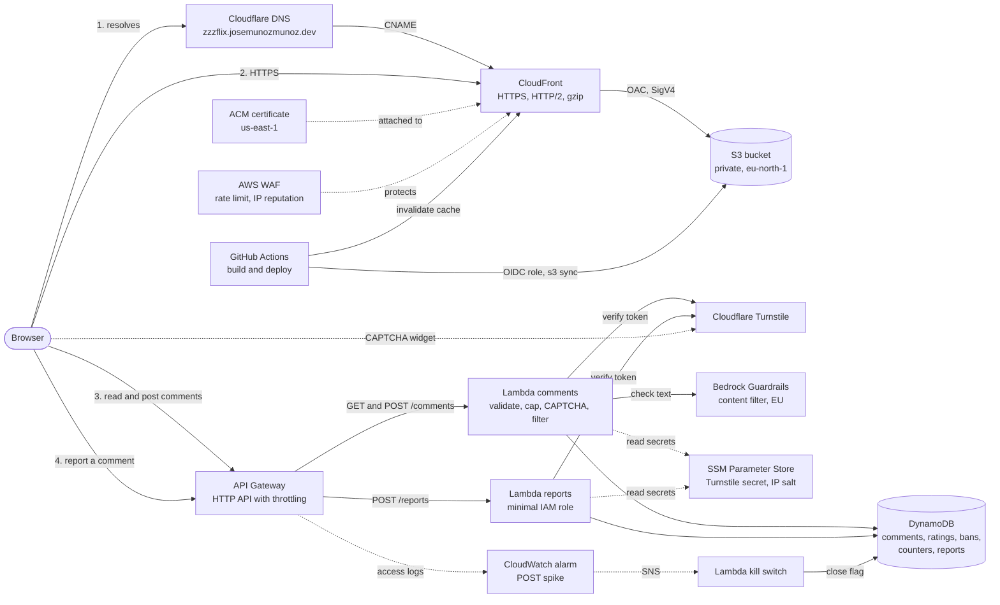

# zzzflix 💤

**Movies and series to fall asleep to.** A small catalog of famously slow, long and meditative films, each one rated by how likely it is to knock you out.

🔗 **Live demo: https://zzzflix.josemunozmunoz.dev**

A personal portfolio project: a React single-page app deployed on AWS as a static site, with the whole infrastructure defined in Terraform.

## Features

- Catalog of ~275 films and series (posters, synopsis in Spanish, runtime) built from the [TMDB API](https://www.themoviedb.org/): a hand-picked core list plus long, well-rated, non-blockbuster films found through TMDB's discovery endpoint. The data is fetched once, at curation time, and committed as a JSON snapshot.
- **Search and pagination** on every list (20 titles per page). Search ignores case and accents, and both the query and the page live in the URL, so the back button and shared links work.
- A community **sleep score** (1–5 💤) for every title: each comment carries a rating, and a title's score is the average of the *approved* ratings. Titles nobody has rated show as "Sin valorar".
- **"Más soporíferas"** ranking, sorted by that score and then by runtime.
- Detail page per title (`/titulo/:id`) with deep links that survive a page refresh.
- **Favorites** persisted in the browser (`localStorage`).
- **Comments** on every title, with a CAPTCHA and automatic moderation: an AI content filter (Amazon Bedrock Guardrails) publishes clean comments instantly and rejects insults, offensive content and personal data. A **report button** sends any published comment to a human review queue.
- Interface in **Spanish, English and German**, with a language selector.
- Responsive grid, dark theme.

## Tech stack

| Area | Technology |
| --- | --- |
| Frontend | React, TypeScript, Vite, React Router, react-i18next |
| Data | TMDB API, fetched by a Node script into a committed JSON snapshot |
| Hosting | Amazon S3 (private) + Amazon CloudFront |
| TLS | AWS Certificate Manager |
| Security | AWS WAF (rate limiting, IP reputation), CloudFront security headers |
| Cost control | AWS Budgets alerts |
| Comments API | Amazon API Gateway (HTTP API), two AWS Lambda functions (Node.js 24: comments and reports), Amazon DynamoDB, SSM Parameter Store |
| Automatic moderation | Amazon Bedrock Guardrails (EU cross-region profile) with its own daily execution cap |
| Anti-abuse | Cloudflare Turnstile, server-side validation, daily caps, IP bans (salted hash), report button, automatic kill switch |
| Operations | CloudWatch dashboard and alarms + SNS email, API access logs, Checkov, Dependabot |
| CI/CD | GitHub Actions with OIDC (no stored AWS keys) |
| DNS | Cloudflare |
| Infrastructure as code | Terraform (AWS, Cloudflare and GitHub providers) |

## Architecture



The site itself is 100% static: there is no server to run or patch. The browser downloads the compiled app, with the catalog already inside it, from CloudFront. The only dynamic part is the comments API, a small serverless backend (API Gateway, two Lambda functions and DynamoDB) that costs nothing while nobody uses it.

### Design decisions

- **Private bucket + Origin Access Control (OAC).** The S3 bucket blocks all public access. Only this specific CloudFront distribution can read it (bucket policy conditioned on the distribution ARN), so the content can only be reached through the CDN.
- **Certificate in `us-east-1`.** CloudFront only accepts ACM certificates from that region, so the project uses a second, aliased AWS provider for it while the bucket lives in `eu-north-1`. The certificate is validated through DNS records created by Terraform in Cloudflare.
- **SPA routing.** React Router routes such as `/soporiferas` or `/titulo/1398` do not exist as files in S3. CloudFront custom error responses turn 403/404 into `index.html` (status 200), so deep links and refreshes work. Trade-off: genuinely missing files also return the app shell, and the router decides what to show.
- **CloudFront Free flat-rate plan.** Subscribed from Terraform (`aws_pricingplanmanager_subscription`). It bundles the CDN, DDoS protection and a managed WAF for $0/month with no overage charges: if traffic exceeds the allowance, delivery is throttled instead of billed.
- **WAF.** A per-IP rate limit and the AWS IP reputation list in front of CloudFront. The Free plan allows up to 5 rules and no CAPTCHA, so the CAPTCHA lives in the comments form (Cloudflare Turnstile) instead.
- **Security headers.** HSTS, `X-Content-Type-Options` and `X-Frame-Options` through the managed CloudFront response headers policy.
- **Automatic moderation with a human fallback.** Every comment goes through Amazon Bedrock Guardrails: content filters (hate, sexual content, violence, misconduct, insults), a profanity word list, and blocking of emails, phone numbers and card or bank-account numbers. If the filter approves, the comment is published immediately and its rating enters the title's average in the same DynamoDB transaction. If it blocks, the comment is rejected with a message and nothing is stored. If the filter is unavailable, the comment is stored as `pending` for manual review. The public endpoint only returns published comments, and React renders their text as plain text, never as HTML. Comment text is processed by AWS in the EU (a cross-region profile limited to EU regions); the logs record only the *type* of a block, never the text.
- **Defense in depth for the comments API.** The frontend checks are only for UX; the Lambda is the real gate. In order: emergency-switch check, input validation (nickname, length, no links or angle brackets), ban check, Turnstile token verified server-side with Cloudflare, a per-IP daily cap and a global daily cap, an independent daily cap on filter executions, the filter itself, and finally the write. The filter cap exists so that even if another layer fails, the AI never runs more than 50 times a day; once it is reached, new comments are rejected instead of piling up as pending. The caps are atomic conditional updates on DynamoDB counters, so concurrent requests cannot overshoot them, and the counters expire on their own (DynamoDB TTL). IPs are stored only as a salted HMAC, and the salt lives in SSM Parameter Store. API Gateway throttling, a Terraform variable that closes the write endpoints (`comments_enabled`) and the automatic kill switch below act as emergency brakes.
- **Automatic kill switch.** A CloudWatch alarm on POST attempts (30 or more in 5 minutes) publishes to an SNS topic that invokes a small Lambda. The Lambda sets a flag in DynamoDB, and both write endpoints (comments and reports) start answering 503 while reading keeps working. It is reopened from the moderation script. Detection takes one to three minutes, so API Gateway throttling remains the first line of defence.
- **Ratings that cannot be gamed in bulk.** A rating only exists inside a comment, so it is filtered like one and only counts once the comment is published. Publishing or approving a comment updates a per-title aggregate (`sum`, `count`) in the same DynamoDB transaction, so the average can never drift from the approved comments. The frontend ranks titles with a weighted average that mixes in two virtual votes of value 1 (the value of an unrated title), so a single 5 cannot jump a title to the top.
- **Moderation from the terminal.** `infra/scripts/moderate.py` handles what the filter could not decide (pending comments) and what people report. It approves, rejects or deletes comments, marks which published ones were approved automatically, shows the day's quota usage, and opens or closes the comments. **Reports** go to a separate queue (`rep`): for each reported comment the moderator can dismiss the reports, delete the comment or ban its author. A report never hides or deletes anything by itself, so nobody can censor a comment by mass reporting; a human decides. Bans work on a salted hash of the IP (the IP itself is never stored): the Lambda saves it with each comment, the script bans that hash, and banned IPs get a 403 on both endpoints before any other work. The script strips control characters from comment text so a comment cannot inject escape sequences into the moderator's terminal.
- **Least privilege, one role per Lambda.** The comments function can use the comments table, read two SSM parameters and call `bedrock:ApplyGuardrail` on one guardrail. The reports function is separate so it can have a much smaller role: it cannot call Bedrock, and it can only write rows whose partition key is `#reports` plus the counter rows (`#limits`), enforced with the `dynamodb:LeadingKeys` IAM condition, so even a bug there could not publish comments or touch ratings and bans. API Gateway can invoke it only through `POST /reports`. The code both functions must run identically (IP hash, CAPTCHA, counters, switches) lives in one shared module that Terraform copies into both zips. The table has deletion protection and point-in-time recovery.
- **Content-Security-Policy.** The CloudFront Free plan does not allow custom response headers, so the CSP is injected as a `<meta>` tag at build time by a small Vite plugin. It restricts scripts to the app and Cloudflare Turnstile, connections to the comments API, and images to the app and TMDB's image host. (A meta CSP cannot use `frame-ancestors` or report-only mode; that is a known limit of this plan.)
- **Monitoring and hygiene.** CloudWatch alarms email me through SNS when a Lambda errors or throttles, when the API returns real server errors (500, 502 and 504; the deliberate 503 of a closed form does not count), when traffic is unusual, and when the filter reaches 80% of its daily cap. A CloudWatch dashboard shows the same signals. API Gateway access logs (14-day retention) allow investigating abuse. The Terraform code is scanned with Checkov, with every skipped check documented in `infra/checkov.yaml`, and Dependabot keeps npm packages, GitHub Actions and Terraform providers up to date.
- **Cost guardrail.** An AWS Budgets alert emails me when the account forecast or spend approaches the monthly threshold.
- **Keyless CI/CD.** GitHub Actions deploys on every push to `main` using OIDC: AWS trusts GitHub's identity token and hands out short-lived credentials, so no AWS keys are stored in GitHub. The IAM role is scoped to this repository and branch (using GitHub's immutable subject claim, which includes the owner and repository IDs) and can only write to the site bucket and invalidate this distribution.
- **No secrets in the repository or in Terraform state.** The Cloudflare token comes from `CLOUDFLARE_API_TOKEN`, the TMDB token from a git-ignored `.env.local`, and the Turnstile secret key and the IP-hash salt live in SSM Parameter Store as `SecureString`, created by hand with the CLI so their values never pass through Terraform. Terraform state and `*.tfvars` are ignored too.
- **Catalog as a build-time snapshot.** `npm run catalog` reads the hand-curated list (`src/data/curated.json`), fetches each title from TMDB and writes `src/data/catalog.json`, which the app imports. The browser never calls the TMDB API, so there is no TMDB token in the frontend bundle, no per-visitor request fan-out, and the page does not depend on TMDB being up. `npm run catalog:add -- "Title" 1975` searches TMDB, checks the year and appends the match to the hand-picked list, and `npm run catalog:discover` proposes more films (long, well rated, mid-sized audience, no action, animation, documentaries or music) into a separate file. Discovered titles are re-checked against the real runtime and the Spanish synopsis, and the hand-picked list always wins. The catalog is loaded on demand as its own chunk, so it does not weigh on the first paint. Trade-off: new titles or updated data need a manual run and a commit.
- **Optimized assets.** The hero logo is a ~20 KB WebP.

### Cost

Serving the site costs cents per month: only S3 storage is billed. CloudFront and the WAF are covered by the Free flat-rate plan, and ACM is free. The comments backend is pay-per-use (on-demand DynamoDB, Lambda, HTTP API), and its worst case is bounded by throttling and the daily caps. Bedrock Guardrails is billed per text unit, and its hard cap of 50 executions a day keeps the worst case at a few tenths of a dollar per month.

## Run it locally

```bash
npm install
npm run dev
```

The catalog is already in the repository, so no API key is needed to run the app. To add or refresh titles you need a free TMDB API key (the *API Read Access Token*) in a git-ignored `.env.local`:

```bash
echo "VITE_TMDB_TOKEN=your_tmdb_read_access_token" > .env.local
npm run catalog:add -- "Stalker" 1979   # search TMDB and add to src/data/curated.json
npm run catalog:discover                # propose more titles (src/data/discovered.json)
npm run catalog                         # regenerate src/data/catalog.json
```

## Deploy

Before the first apply, create the two secrets the Lambdas read from SSM Parameter Store. They are made by hand so their values never pass through Terraform or its state:

```bash
read -rs TURNSTILE_SECRET   # the Turnstile secret key
aws ssm put-parameter --region eu-north-1 --name /zzzflix/turnstile-secret \
  --type SecureString --value "$TURNSTILE_SECRET"; unset TURNSTILE_SECRET
aws ssm put-parameter --region eu-north-1 --name /zzzflix/ip-salt \
  --type SecureString --value "$(openssl rand -hex 32)"
```

Keep the salt: if it changes, existing IP bans stop matching.

Infrastructure (requires AWS credentials, plus `CLOUDFLARE_API_TOKEN` and `GITHUB_TOKEN` in the environment; the GitHub token only needs *Variables: Read and write* on this repository):

```bash
cd infra
# set your Cloudflare zone id in infra/terraform.tfvars (git-ignored):
#   cloudflare_zone_id = "..."
#   alert_email        = "..."
terraform init
terraform plan
terraform apply
```

The site is deployed automatically by GitHub Actions on every push to `main` (`.github/workflows/deploy.yml`). It needs the repository secret `AWS_ROLE_ARN` (Terraform output `github_deploy_role_arn`), and the repository variables `S3_BUCKET`, `CF_DISTRIBUTION_ID`, `COMMENTS_API_URL` and `TURNSTILE_SITE_KEY`, which Terraform keeps in sync through the GitHub provider, so recreating the infrastructure needs no manual step.

Manual deploy, equivalent to what the workflow does:

```bash
npm run build
aws s3 sync dist/ "s3://$(terraform -chdir=infra output -raw bucket_name)" --delete
aws cloudfront create-invalidation \
  --distribution-id "$(terraform -chdir=infra output -raw distribution_id)" --paths "/*"
```

## Moderation

Published comments were already checked by the filter. What needs a human is whatever the filter could not decide (pending) and whatever people report. From a Python environment with `boto3` and AWS credentials:

```bash
python infra/scripts/moderate.py
```

| Command | What it does |
| --- | --- |
| `p`, `a N`, `r N` | List pending comments, approve or reject them |
| `ok`, `x N` | List published comments (`[auto]` = published by the filter), delete one |
| `rep` | Reported comments, most reported first. In that view: `d N` dismisses the reports, `x N` deletes the comment, `b N` bans its author |
| `banip IP`, `bans`, `unban N` | Manage IP bans |
| `cupo` | Today's usage of the daily caps (comments, filter executions, reports) |
| `estado`, `cerrar`, `abrir` | Check, close or reopen the write endpoints |

## CI/CD and security

- **CI on every pull request:** the app is built and the Terraform code is scanned with Checkov. Both checks are required to merge into `main`.
- **Deploy:** merging into `main` publishes the site to AWS (S3 + CloudFront) from GitHub Actions, authenticating with OIDC, so there are no long-lived AWS keys in the repository.
- **Branch protection:** `main` is protected by a ruleset (pull request and passing checks required, no force pushes, no deletion).
- **Code and dependency scanning:** CodeQL, Dependabot (npm, GitHub Actions and Terraform), secret scanning and push protection are enabled.

## Known limitations

- The catalog is a snapshot: new titles or refreshed TMDB data require running `npm run catalog` and committing the result.
- Favorites live in the browser only, so they are not shared across devices.
- Moderation happens in a terminal script that needs my AWS credentials; there is no admin page yet.
- Ratings are only as trustworthy as the filter and the moderation behind them: the filter looks for insults and personal data, not for dishonest ratings, so a genuine-looking comment with a fake rating can still be published. The CAPTCHA, the caps, bans and the report button limit manipulation but do not make it impossible, which is why a title's score is shown together with its number of votes.
- API Gateway throttling is best-effort, so it works as a brake and not as an exact limit. The exact limits are the daily caps enforced in the Lambda. The caps reset at midnight UTC, and a determined attacker with many IPs could still use up the global cap and block new comments for the day, which is the accepted trade-off to keep the cost bounded. The report button has its own, smaller daily caps with the same trade-off.
- The filter is a classifier: it can miss things and can block harmless text. The link rule is a pattern (`http://`, `www.` and common domain endings), so addresses with other endings such as `.es` or `.de`, or deliberately disguised ones, can slip through. That is what the report button is for.
- IP bans are a speed bump: a VPN or a mobile network changes the IP, and a shared IP can affect innocent users.
- The guardrail runs as its working draft version; a numbered version would make changes reviewable and reversible.

## Roadmap

- [x] AWS WAF in front of CloudFront (rate limiting and IP reputation).
- [x] CAPTCHA (Cloudflare Turnstile) on the comments form, verified server-side.
- [x] CI/CD with GitHub Actions authenticating to AWS through OIDC (no long-lived keys).
- [x] Comments API with a moderation queue, daily caps and an emergency switch.
- [x] Community ratings, moderation script and IP bans.
- [x] Alarms, Content-Security-Policy, Checkov and Dependabot.
- [x] Automatic moderation with Amazon Bedrock Guardrails, with its own daily cap.
- [x] Report button, with a separate Lambda and a minimal IAM role.
- [x] Secrets in SSM Parameter Store, automatic kill switch and CloudWatch dashboard.
- [ ] Small admin page (Amazon Cognito) to moderate without the CLI.
- [ ] OWASP ZAP baseline scan and a review of the security headers.
- [x] Catalog snapshot at curation time: no TMDB token in the frontend.

## Credits

This product uses the TMDB API but is not endorsed or certified by [TMDB](https://www.themoviedb.org/).

## License

MIT © Jose Muñoz Muñoz
