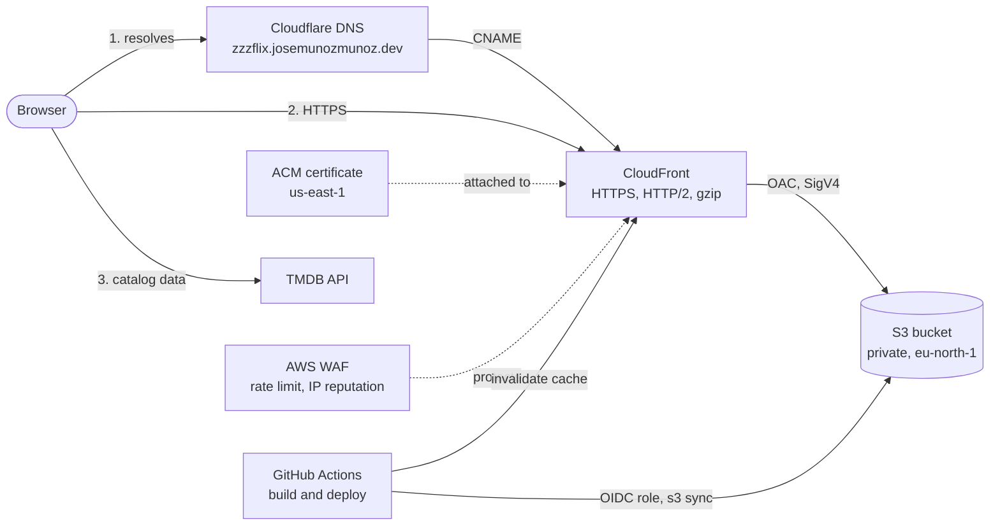

# zzzflix 💤

**Movies and series to fall asleep to.** A small catalog of famously slow, long and meditative films, each one rated by how likely it is to knock you out.

🔗 **Live demo: https://zzzflix.josemunozmunoz.dev**

A personal portfolio project: a React single-page app deployed on AWS as a static site, with the whole infrastructure defined in Terraform.

## Features

- Catalog of films and series loaded from the [TMDB API](https://www.themoviedb.org/) (posters, synopsis in Spanish, runtime).
- A curated **sleep score** (1–5 💤) for every title.
- **"Más soporíferas"** ranking, sorted by sleep score and then by runtime.
- Detail page per title (`/titulo/:id`) with deep links that survive a page refresh.
- **Favorites** persisted in the browser (`localStorage`).
- Responsive grid, dark theme.

## Tech stack

| Area | Technology |
| --- | --- |
| Frontend | React, TypeScript, Vite, React Router |
| Data | TMDB API (`fetch`, `Promise.allSettled`) |
| Hosting | Amazon S3 (private) + Amazon CloudFront |
| TLS | AWS Certificate Manager |
| Security | AWS WAF (rate limiting, IP reputation), CloudFront security headers |
| Cost control | AWS Budgets alerts |
| CI/CD | GitHub Actions with OIDC (no stored AWS keys) |
| DNS | Cloudflare |
| Infrastructure as code | Terraform (AWS, Cloudflare and GitHub providers) |

## Architecture



The site is 100% static: there is no server to run or patch. The browser downloads the compiled app from CloudFront and then calls TMDB directly for the catalog data.

### Design decisions

- **Private bucket + Origin Access Control (OAC).** The S3 bucket blocks all public access. Only this specific CloudFront distribution can read it (bucket policy conditioned on the distribution ARN), so the content can only be reached through the CDN.
- **Certificate in `us-east-1`.** CloudFront only accepts ACM certificates from that region, so the project uses a second, aliased AWS provider for it while the bucket lives in `eu-north-1`. The certificate is validated through DNS records created by Terraform in Cloudflare.
- **SPA routing.** React Router routes such as `/soporiferas` or `/titulo/1398` do not exist as files in S3. CloudFront custom error responses turn 403/404 into `index.html` (status 200), so deep links and refreshes work. Trade-off: genuinely missing files also return the app shell, and the router decides what to show.
- **CloudFront Free flat-rate plan.** Subscribed from Terraform (`aws_pricingplanmanager_subscription`). It bundles the CDN, DDoS protection and a managed WAF for $0/month with no overage charges: if traffic exceeds the allowance, delivery is throttled instead of billed.
- **WAF.** A per-IP rate limit and the AWS IP reputation list in front of CloudFront. The Free plan allows up to 5 rules and no CAPTCHA, so the CAPTCHA is reserved for the future comments form.
- **Security headers.** HSTS, `X-Content-Type-Options` and `X-Frame-Options` through the managed CloudFront response headers policy.
- **Cost guardrail.** An AWS Budgets alert emails me when the account forecast or spend approaches the monthly threshold.
- **Keyless CI/CD.** GitHub Actions deploys on every push to `main` using OIDC: AWS trusts GitHub's identity token and hands out short-lived credentials, so no AWS keys are stored in GitHub. The IAM role is scoped to this repository and branch (using GitHub's immutable subject claim, which includes the owner and repository IDs) and can only write to the site bucket and invalidate this distribution.
- **No secrets in the repository.** The Cloudflare token comes from `CLOUDFLARE_API_TOKEN`, the TMDB token from a git-ignored `.env.local`, and Terraform state and `*.tfvars` are ignored too.
- **Optimized assets.** The hero logo is a ~20 KB WebP.

### Cost

Serving the site costs cents per month: only S3 storage is billed. CloudFront and the WAF are covered by the Free flat-rate plan, and ACM is free.

## Run it locally

```bash
npm install
echo "VITE_TMDB_TOKEN=your_tmdb_read_access_token" > .env.local
npm run dev
```

You need a free TMDB API key (use the *API Read Access Token*). `.env.local` is git-ignored.

## Deploy

Infrastructure (requires AWS credentials, `CLOUDFLARE_API_TOKEN` and `GITHUB_TOKEN` in the environment; the GitHub token only needs *Variables: Read and write* on this repository):

```bash
cd infra
# set your Cloudflare zone id in infra/terraform.tfvars (git-ignored):
#   cloudflare_zone_id = "..."
#   alert_email        = "..."
terraform init
terraform plan
terraform apply
```

The site is deployed automatically by GitHub Actions on every push to `main` (`.github/workflows/deploy.yml`). It needs the repository secrets `VITE_TMDB_TOKEN` and `AWS_ROLE_ARN` (Terraform output `github_deploy_role_arn`), and the repository variables `S3_BUCKET` and `CF_DISTRIBUTION_ID`, which Terraform keeps in sync through the GitHub provider, so recreating the infrastructure needs no manual step.

Manual deploy, equivalent to what the workflow does:

```bash
npm run build
aws s3 sync dist/ "s3://$(terraform -chdir=infra output -raw bucket_name)" --delete
aws cloudfront create-invalidation \
  --distribution-id "$(terraform -chdir=infra output -raw distribution_id)" --paths "/*"
```

## Known limitations

- The TMDB token is bundled into the frontend, so anyone can read it from the browser. It is a free, read-only token for public data, which is acceptable for a demo; a small proxy (for example an AWS Lambda) would be the proper fix.
- Favorites live in the browser only, so they are not shared across devices.

## Roadmap

- [x] AWS WAF in front of CloudFront (rate limiting and IP reputation).
- [ ] CAPTCHA (Cloudflare Turnstile) on the future comments form.
- [x] CI/CD with GitHub Actions authenticating to AWS through OIDC (no long-lived keys).
- [ ] Reviews and comments with an API behind it, moderated with Amazon Bedrock Guardrails.
- [ ] Lambda proxy for the TMDB token.

## Credits

This product uses the TMDB API but is not endorsed or certified by [TMDB](https://www.themoviedb.org/).

## License

MIT © Jose Muñoz Muñoz
