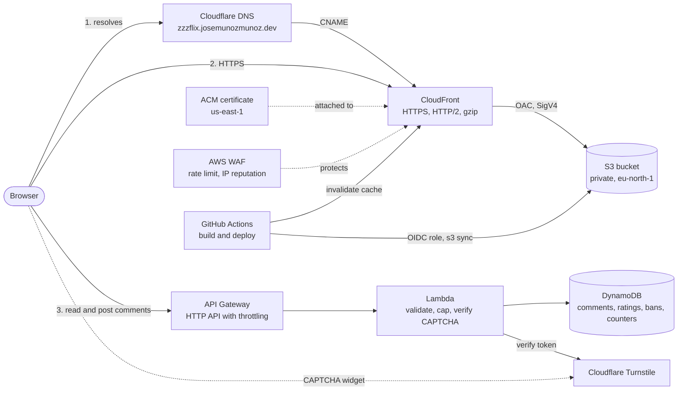

# zzzflix 💤

**Movies and series to fall asleep to.** A small catalog of famously slow, long and meditative films, each one rated by how likely it is to knock you out.

🔗 **Live demo: https://zzzflix.josemunozmunoz.dev**

A personal portfolio project: a React single-page app deployed on AWS as a static site, with the whole infrastructure defined in Terraform.

## Features

- Catalog of ~275 films and series (posters, synopsis in Spanish, runtime) built from the [TMDB API](https://www.themoviedb.org/): a hand-picked core list plus long, well-rated, non-blockbuster films found through TMDB's discovery endpoint. The data is fetched once, at curation time, and committed as a JSON snapshot.
- **Search and pagination** on every list (20 titles per page). Search ignores case and accents, and both the query and the page live in the URL, so the back button and shared links work.
- A community **sleep score** (1–5 💤) for every title: each comment carries a rating, and a title's score is the average of the *approved* ratings. Titles nobody has rated show as "Sin valorar".
- **"Más soporíferas"** ranking, sorted by that score and then by runtime.
- Detail page per title (`/titulo/:id`) with deep links that survive a page refresh.
- **Favorites** persisted in the browser (`localStorage`).
- **Comments** on every title, with a CAPTCHA and a moderation queue: new comments (and their ratings) stay hidden until approved.
- Responsive grid, dark theme.

## Tech stack

| Area | Technology |
| --- | --- |
| Frontend | React, TypeScript, Vite, React Router |
| Data | TMDB API, fetched by a Node script into a committed JSON snapshot |
| Hosting | Amazon S3 (private) + Amazon CloudFront |
| TLS | AWS Certificate Manager |
| Security | AWS WAF (rate limiting, IP reputation), CloudFront security headers |
| Cost control | AWS Budgets alerts |
| Comments API | Amazon API Gateway (HTTP API), AWS Lambda (Node.js 22), Amazon DynamoDB |
| Anti-abuse | Cloudflare Turnstile, server-side validation, daily caps, IP bans, emergency switch |
| Operations | CloudWatch alarms + SNS email, API access logs, Checkov, Dependabot |
| CI/CD | GitHub Actions with OIDC (no stored AWS keys) |
| DNS | Cloudflare |
| Infrastructure as code | Terraform (AWS, Cloudflare and GitHub providers) |

## Architecture



The site itself is 100% static: there is no server to run or patch. The browser downloads the compiled app, with the catalog already inside it, from CloudFront. The only dynamic part is the comments API, a small serverless backend (API Gateway, Lambda and DynamoDB) that costs nothing while nobody uses it.

### Design decisions

- **Private bucket + Origin Access Control (OAC).** The S3 bucket blocks all public access. Only this specific CloudFront distribution can read it (bucket policy conditioned on the distribution ARN), so the content can only be reached through the CDN.
- **Certificate in `us-east-1`.** CloudFront only accepts ACM certificates from that region, so the project uses a second, aliased AWS provider for it while the bucket lives in `eu-north-1`. The certificate is validated through DNS records created by Terraform in Cloudflare.
- **SPA routing.** React Router routes such as `/soporiferas` or `/titulo/1398` do not exist as files in S3. CloudFront custom error responses turn 403/404 into `index.html` (status 200), so deep links and refreshes work. Trade-off: genuinely missing files also return the app shell, and the router decides what to show.
- **CloudFront Free flat-rate plan.** Subscribed from Terraform (`aws_pricingplanmanager_subscription`). It bundles the CDN, DDoS protection and a managed WAF for $0/month with no overage charges: if traffic exceeds the allowance, delivery is throttled instead of billed.
- **WAF.** A per-IP rate limit and the AWS IP reputation list in front of CloudFront. The Free plan allows up to 5 rules and no CAPTCHA, so the CAPTCHA lives in the comments form (Cloudflare Turnstile) instead.
- **Security headers.** HSTS, `X-Content-Type-Options` and `X-Frame-Options` through the managed CloudFront response headers policy.
- **Comments behind a moderation queue.** Anyone can post, but a comment is stored as `pending` and the public endpoint only returns approved ones. Text is rendered as plain text by React, never as HTML.
- **Defense in depth for the comments API.** The frontend checks are only for UX; the Lambda is the real gate. In order: input validation (nickname, length, no links or angle brackets), Turnstile token verified server-side with Cloudflare, a per-IP daily cap and a global daily cap, and finally the write. The caps are atomic conditional updates on DynamoDB counters, so concurrent requests cannot overshoot them, and the counters expire on their own (DynamoDB TTL). IPs are stored only as a hash. API Gateway throttling and a Terraform variable that closes the POST endpoint (`comments_enabled`) act as an emergency brake.
- **Ratings that cannot be gamed in bulk.** A rating only exists inside a comment, so it is moderated like one and only counts once approved. Approving a comment updates a per-title aggregate (`sum`, `count`) in the same DynamoDB transaction, so the average can never drift from the approved comments. The frontend ranks titles with a weighted average that mixes in two virtual votes of value 1 (the value of an unrated title), so a single 5 cannot jump a title to the top.
- **Moderation from the terminal.** `infra/scripts/moderate.py` lists pending comments and approves, rejects or deletes them. It can also ban an author: the Lambda stores a hash of the IP (never the IP itself) with each comment, the script bans that hash, and banned IPs get a 403 before any other work. The script strips control characters from comment text so a comment cannot inject escape sequences into the moderator's terminal.
- **Least privilege for the Lambda.** Its role can only get, put, query and update items in the comments table, plus write its own logs. The table has deletion protection and point-in-time recovery.
- **Content-Security-Policy.** The CloudFront Free plan does not allow custom response headers, so the CSP is injected as a `<meta>` tag at build time by a small Vite plugin. It restricts scripts to the app and Cloudflare Turnstile, connections to the comments API, and images to the app and TMDB's image host. (A meta CSP cannot use `frame-ancestors` or report-only mode; that is a known limit of this plan.)
- **Monitoring and hygiene.** CloudWatch alarms email me through SNS when the comments Lambda errors or throttles, or the API gets unusual traffic. API Gateway access logs (14-day retention) allow investigating abuse. The Terraform code is scanned with Checkov, with every skipped check documented in `infra/checkov.yaml`, and Dependabot keeps npm packages, GitHub Actions and Terraform providers up to date.
- **Cost guardrail.** An AWS Budgets alert emails me when the account forecast or spend approaches the monthly threshold.
- **Keyless CI/CD.** GitHub Actions deploys on every push to `main` using OIDC: AWS trusts GitHub's identity token and hands out short-lived credentials, so no AWS keys are stored in GitHub. The IAM role is scoped to this repository and branch (using GitHub's immutable subject claim, which includes the owner and repository IDs) and can only write to the site bucket and invalidate this distribution.
- **No secrets in the repository.** The Cloudflare token comes from `CLOUDFLARE_API_TOKEN`, the TMDB token from a git-ignored `.env.local`, and Terraform state and `*.tfvars` are ignored too.
- **Catalog as a build-time snapshot.** `npm run catalog` reads the hand-curated list (`src/data/curated.json`), fetches each title from TMDB and writes `src/data/catalog.json`, which the app imports. The browser never calls the TMDB API, so there is no TMDB token in the frontend bundle, no per-visitor request fan-out, and the page does not depend on TMDB being up. `npm run catalog:add -- "Title" 1975` searches TMDB, checks the year and appends the match to the hand-picked list, and `npm run catalog:discover` proposes more films (long, well rated, mid-sized audience, no action, animation, documentaries or music) into a separate file. Discovered titles are re-checked against the real runtime and the Spanish synopsis, and the hand-picked list always wins. The catalog is loaded on demand as its own chunk, so it does not weigh on the first paint. Trade-off: new titles or updated data need a manual run and a commit.
- **Optimized assets.** The hero logo is a ~20 KB WebP.

### Cost

Serving the site costs cents per month: only S3 storage is billed. CloudFront and the WAF are covered by the Free flat-rate plan, and ACM is free. The comments backend is pay-per-use (on-demand DynamoDB, Lambda, HTTP API), and its worst case is bounded by throttling and the daily caps.

## Run it locally

```bash
npm install
npm run dev
```

The catalog is already in the repository, so no API key is needed to run the app. To add or refresh titles you need a free TMDB API key (the *API Read Access Token*) in a git-ignored `.env.local`:

```bash
echo "VITE_TMDB_TOKEN=your_tmdb_read_access_token" > .env.local
npm run catalog:add -- "Stalker" 1979   # search TMDB and add to src/data/curated.json
npm run catalog:discover                # propose more titles (src/data/discovered.json)
npm run catalog                         # regenerate src/data/catalog.json
```

## Deploy

Infrastructure (requires AWS credentials, `CLOUDFLARE_API_TOKEN`, `GITHUB_TOKEN` and `TF_VAR_turnstile_secret`, the Turnstile secret key, in the environment; the GitHub token only needs *Variables: Read and write* on this repository):

```bash
cd infra
# set your Cloudflare zone id in infra/terraform.tfvars (git-ignored):
#   cloudflare_zone_id = "..."
#   alert_email        = "..."
terraform init
terraform plan
terraform apply
```

The site is deployed automatically by GitHub Actions on every push to `main` (`.github/workflows/deploy.yml`). It needs the repository secret `AWS_ROLE_ARN` (Terraform output `github_deploy_role_arn`), and the repository variables `S3_BUCKET`, `CF_DISTRIBUTION_ID`, `COMMENTS_API_URL` and `TURNSTILE_SITE_KEY`, which Terraform keeps in sync through the GitHub provider, so recreating the infrastructure needs no manual step.

Manual deploy, equivalent to what the workflow does:

```bash
npm run build
aws s3 sync dist/ "s3://$(terraform -chdir=infra output -raw bucket_name)" --delete
aws cloudfront create-invalidation \
  --distribution-id "$(terraform -chdir=infra output -raw distribution_id)" --paths "/*"
```

## Known limitations

- The catalog is a snapshot: new titles or refreshed TMDB data require running `npm run catalog` and committing the result.
- Favorites live in the browser only, so they are not shared across devices.
- Comments are approved from a terminal script that needs my AWS credentials; there is no admin page yet.
- Ratings are as trustworthy as the moderation behind them: anyone can submit a comment with a rating, and I approve what looks genuine. Per-IP and global daily caps, the CAPTCHA and bans limit manipulation, but they do not make it impossible, which is why a title's score is shown together with its number of votes.
- API Gateway throttling is best-effort, so it works as a brake and not as an exact limit. The exact limits are the daily caps enforced in the Lambda. The caps reset at midnight UTC, and a determined attacker with many IPs could still use up the global cap and block new comments for the day, which is the accepted trade-off to keep the cost bounded.
- The Turnstile secret is passed to the Lambda as an environment variable, so it ends up in the Terraform state; SSM Parameter Store would be the next step.

## Roadmap

- [x] AWS WAF in front of CloudFront (rate limiting and IP reputation).
- [x] CAPTCHA (Cloudflare Turnstile) on the comments form, verified server-side.
- [x] CI/CD with GitHub Actions authenticating to AWS through OIDC (no long-lived keys).
- [x] Comments API with a moderation queue, daily caps and an emergency switch.
- [x] Community ratings, moderation script and IP bans.
- [x] Alarms, Content-Security-Policy, Checkov and Dependabot.
- [ ] Automatic moderation with Amazon Bedrock Guardrails.
- [ ] Small admin page to approve comments without the CLI.
- [x] Catalog snapshot at curation time: no TMDB token in the frontend.

## Credits

This product uses the TMDB API but is not endorsed or certified by [TMDB](https://www.themoviedb.org/).

## License

MIT © Jose Muñoz Muñoz
